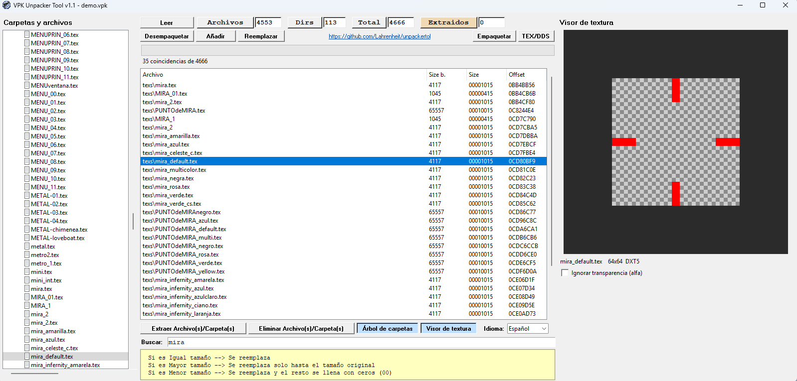

#  VPK Unpacker Tool

  
 


Versión del unpaker ahora en python con más utilidades agregadas, para Torrente On-Line

🌐 **[Español](#español) · [Português](#português) · [English](#english)**

---
**Vista previa del programa:**



---

<a name="español"></a>
## 🇪🇸 Español

Herramienta en Python para **desempaquetar, empaquetar y editar** el archivo `demo.vpk` de **Torrente Online** (formato `vtPack`), con una interfaz gráfica inspirada en el UnpaKer original. La interfaz está disponible en Español, Português e English.

### Características

- **Leer** un `demo.vpk` y listar su contenido (archivos, carpetas, tamaño y offset).
- **Desempaquetar** todo el VPK a una carpeta y **Empaquetar** una carpeta en un nuevo `demo.vpk`.
- **Extraer** archivos o carpetas sueltas (selección múltiple con `Shift` / `Ctrl`).
- **Añadir**, **Reemplazar** y **Eliminar** archivos/carpetas directamente dentro del VPK.
  - Copia de seguridad automática `.bak` antes del primer cambio de cada sesión.
  - Confirmación al eliminar y al reemplazar un archivo que ya existe.
- **Buscador** en vivo ("Buscar:"): filtra la lista mientras escribes.
- **Árbol de carpetas y archivos** a la izquierda, sincronizado con la lista.
- **Visor de texturas** a la derecha: al elegir un `.tex` se muestra la imagen (DXT1 / DXT5).
- Botones para **mostrar u ocultar** el árbol y el visor (ambos activados por defecto).
- Conversión **TEX ⇄ DDS**.
- Barra de progreso, selector de idioma (ES / PT / EN) y modo consola.

### Requisitos

- Python 3.8 o superior y `tkinter` (incluido en el instalador oficial de Python para Windows).
- No necesita librerías externas.

### Uso

**Interfaz gráfica**

```bash
python vpk_tool.py
```

1. Pulsa **Leer** y elige tu `demo.vpk` (por ejemplo `E:\Juegos\Torrente On-Line\demo.vpk`).
2. Selecciona elementos en la lista o en el árbol y usa **Extraer**, **Añadir**, **Reemplazar** o **Eliminar**.
3. **Desempaquetar** / **Empaquetar** trabajan sobre el VPK completo.

**Línea de comandos**

```bash
python vpk_tool.py list demo.vpk                         # listar contenido
python vpk_tool.py unpack demo.vpk carpeta_salida        # desempaquetar todo
python vpk_tool.py pack carpeta_origen demo_nuevo.vpk    # empaquetar una carpeta
python vpk_tool.py extract demo.vpk "texs\chart" salida  # extraer un archivo o carpeta
python vpk_tool.py texdds archivo.tex --salida convertidos
python vpk_tool.py menu                                  # menú de texto
```

### Crear un `.exe` (auto-py-to-exe / PyInstaller)

- Modo *One File* y *Window Based* (sin consola).
- Añade tu `.ico` en **Icon** y también como **archivo adicional**, para que se vea en la ventana y en la barra de tareas.
- Si el enlace de GitHub no abre en el `.exe`, añade `webbrowser` en **Hidden Imports**.

### Aviso

- Haz siempre una copia de tu `demo.vpk` antes de modificarlo. El programa crea un `.bak`, pero no está de más tener otra.
- Herramienta no oficial hecha por fans. Úsala bajo tu propia responsabilidad.
- *Torrente Online* y sus recursos pertenecen a sus respectivos propietarios; este repositorio no incluye ningún archivo del juego.

---

<a name="português"></a>
## 🇧🇷 Português

Ferramenta em Python para **desempacotar, empacotar e editar** o arquivo `demo.vpk` do **Torrente Online** (formato `vtPack`), com uma interface gráfica inspirada no UnpaKer original. A interface está disponível em Español, Português e English.

### Recursos

- **Ler** um `demo.vpk` e listar seu conteúdo (arquivos, pastas, tamanho e offset).
- **Desempacotar** todo o VPK para uma pasta e **Empacotar** uma pasta em um novo `demo.vpk`.
- **Extrair** arquivos ou pastas individuais (seleção múltipla com `Shift` / `Ctrl`).
- **Adicionar**, **Substituir** e **Excluir** arquivos/pastas diretamente dentro do VPK.
  - Backup automático `.bak` antes da primeira alteração de cada sessão.
  - Confirmação ao excluir e ao substituir um arquivo que já existe.
- **Busca** em tempo real ("Buscar:"): filtra a lista enquanto você digita.
- **Árvore de pastas e arquivos** à esquerda, sincronizada com a lista.
- **Visualizador de texturas** à direita: ao escolher um `.tex`, a imagem é exibida (DXT1 / DXT5).
- Botões para **mostrar ou ocultar** a árvore e o visualizador (ambos ativados por padrão).
- Conversão **TEX ⇄ DDS**.
- Barra de progresso, seletor de idioma (ES / PT / EN) e modo console.

### Requisitos

- Python 3.8 ou superior e `tkinter` (incluído no instalador oficial do Python para Windows).
- Não precisa de bibliotecas externas.

### Uso

**Interface gráfica**

```bash
python vpk_tool.py
```

1. Clique em **Ler** e escolha seu `demo.vpk` (por exemplo `E:\Juegos\Torrente On-Line\demo.vpk`).
2. Selecione itens na lista ou na árvore e use **Extrair**, **Adicionar**, **Substituir** ou **Excluir**.
3. **Desempacotar** / **Empacotar** atuam sobre o VPK inteiro.

**Linha de comando**

```bash
python vpk_tool.py list demo.vpk                         # listar conteúdo
python vpk_tool.py unpack demo.vpk pasta_saida           # desempacotar tudo
python vpk_tool.py pack pasta_origem demo_novo.vpk       # empacotar uma pasta
python vpk_tool.py extract demo.vpk "texs\chart" saida   # extrair um arquivo ou pasta
python vpk_tool.py texdds arquivo.tex --salida convertidos
python vpk_tool.py menu                                  # menu de texto
```

### Criar um `.exe` (auto-py-to-exe / PyInstaller)

- Modo *One File* e *Window Based* (sem console).
- Adicione seu `.ico` em **Icon** e também como **arquivo adicional**, para que apareça na janela e na barra de tarefas.
- Se o link do GitHub não abrir no `.exe`, adicione `webbrowser` em **Hidden Imports**.

### Aviso

- Sempre faça uma cópia do seu `demo.vpk` antes de modificá-lo. O programa cria um `.bak`, mas é bom ter outra cópia.
- Ferramenta não oficial feita por fãs. Use por sua conta e risco.
- *Torrente Online* e seus recursos pertencem aos respectivos proprietários; este repositório não inclui nenhum arquivo do jogo.

---

<a name="english"></a>
## 🇬🇧 English

A Python tool to **unpack, pack and edit** Torrente Online's `demo.vpk` file (`vtPack` format), with a graphical interface inspired by the original UnpaKer. The interface is available in Español, Português and English.

### Features

- **Read** a `demo.vpk` and list its contents (files, folders, size and offset).
- **Unpack** the whole VPK into a folder and **Pack** a folder into a new `demo.vpk`.
- **Extract** individual files or folders (multi-select with `Shift` / `Ctrl`).
- **Add**, **Replace** and **Delete** files/folders directly inside the VPK.
  - Automatic `.bak` backup before the first change of each session.
  - Confirmation when deleting and when replacing a file that already exists.
- Live **search** ("Search:"): filters the list as you type.
- **Folder and file tree** on the left, synced with the list.
- **Texture viewer** on the right: selecting a `.tex` shows the image (DXT1 / DXT5).
- Buttons to **show or hide** the tree and the viewer (both on by default).
- **TEX ⇄ DDS** conversion.
- Progress bar, language selector (ES / PT / EN) and console mode.

### Requirements

- Python 3.8 or newer and `tkinter` (included in the official Python installer for Windows).
- No external libraries needed.

### Usage

**Graphical interface**

```bash
python vpk_tool.py
```

1. Click **Read** and choose your `demo.vpk` (for example `E:\Juegos\Torrente On-Line\demo.vpk`).
2. Select items in the list or in the tree and use **Extract**, **Add**, **Replace** or **Delete**.
3. **Unpack** / **Pack** work on the whole VPK.

**Command line**

```bash
python vpk_tool.py list demo.vpk                         # list contents
python vpk_tool.py unpack demo.vpk output_folder         # unpack everything
python vpk_tool.py pack source_folder new_demo.vpk       # pack a folder
python vpk_tool.py extract demo.vpk "texs\chart" out     # extract a file or folder
python vpk_tool.py texdds file.tex --salida converted
python vpk_tool.py menu                                  # text menu
```

### Building an `.exe` (auto-py-to-exe / PyInstaller)

- *One File* and *Window Based* (no console) modes.
- Add your `.ico` under **Icon** and also as an **additional file**, so it shows on the window and in the taskbar.
- If the GitHub link does not open in the `.exe`, add `webbrowser` under **Hidden Imports**.

### Disclaimer

- Always keep a copy of your `demo.vpk` before modifying it. The program creates a `.bak`, but an extra copy never hurts.
- Unofficial fan-made tool. Use at your own risk.
- *Torrente Online* and its assets belong to their respective owners; this repository does not include any game files.

---

## `vtPack` format / Formato / Formato

All values are little endian. / Todos los valores son *little endian*. / Todos os valores são *little endian*.

| Offset | Content / Contenido / Conteúdo |
|--------|-----------|
| `0x00` | `vtPack` + 16 bytes |
| `0x16` | Header size / Tamaño de cabecera / Tamanho do cabeçalho (`0x22`) |
| `0x1A` | Record count / Cantidad de registros / Quantidade de registros |
| `0x1E` | TOC offset |
| `0x22` | File data, contiguous, uncompressed / Datos / Dados |
| TOC    | Records until EOF / Registros hasta el final / Registros até o final |

`.tex` (`TeX2`): byte 4 = format / formato (0 = DXT1, 1 = DXT5); width, height, size / ancho, alto, tamaño / largura, altura, tamanho as `u32`; data / datos / dados from byte 21.
